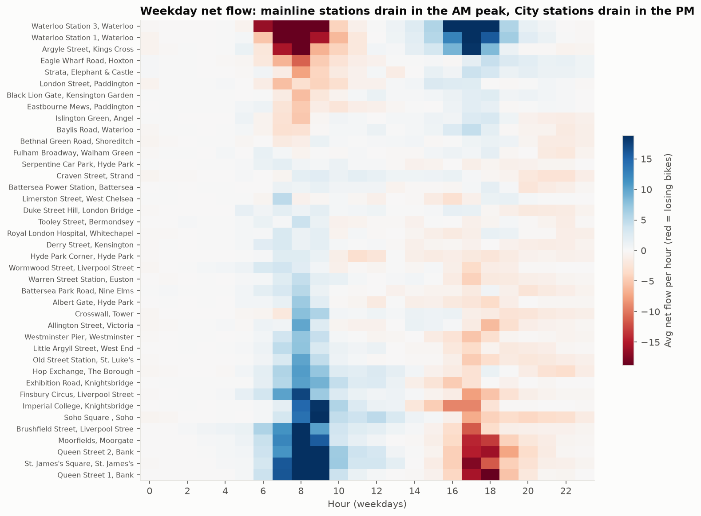
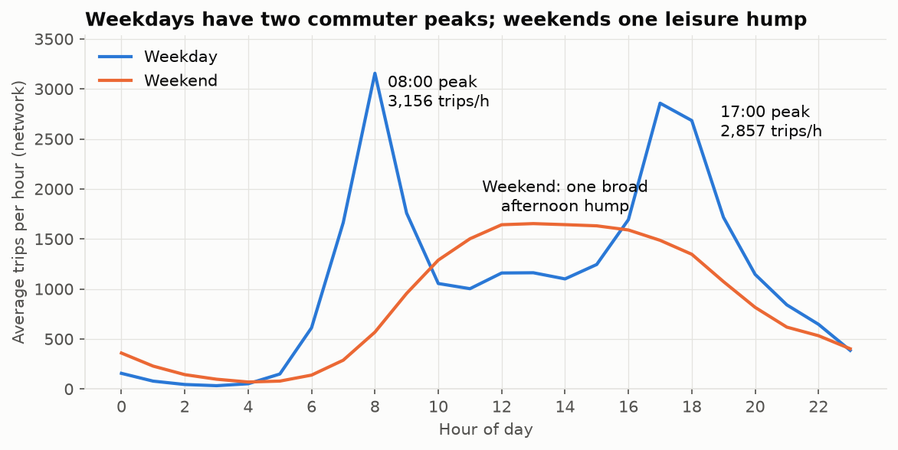
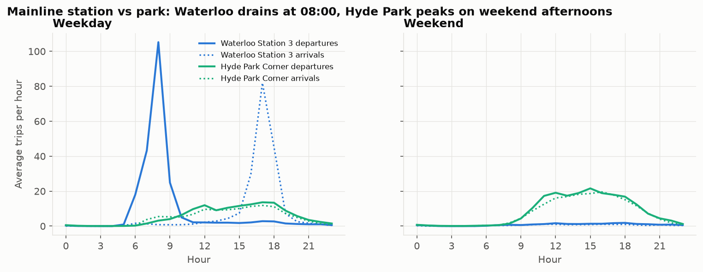
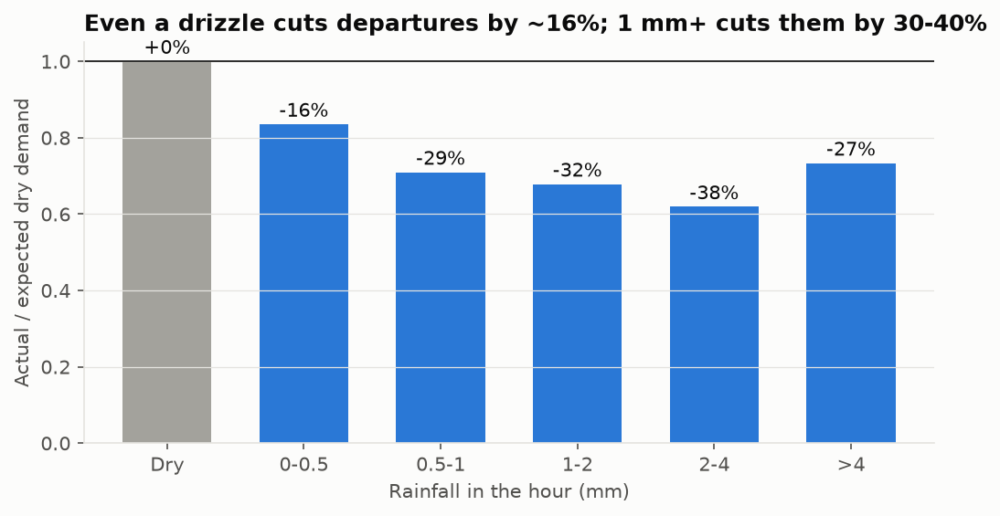
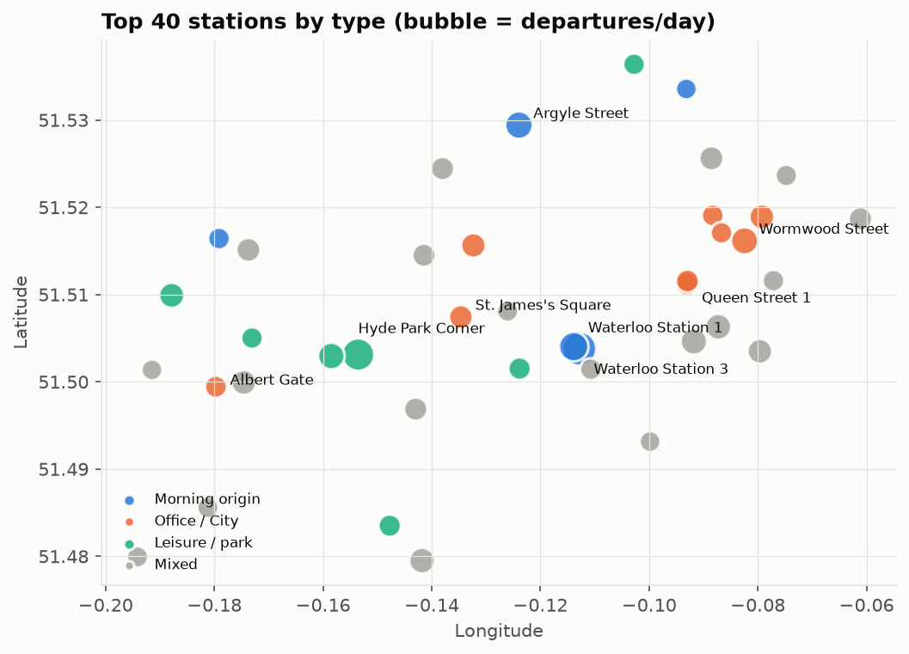
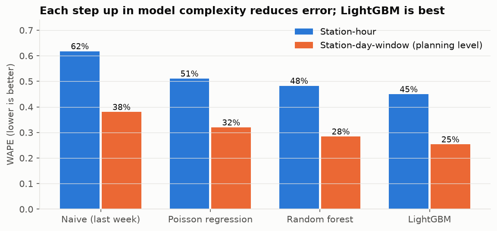
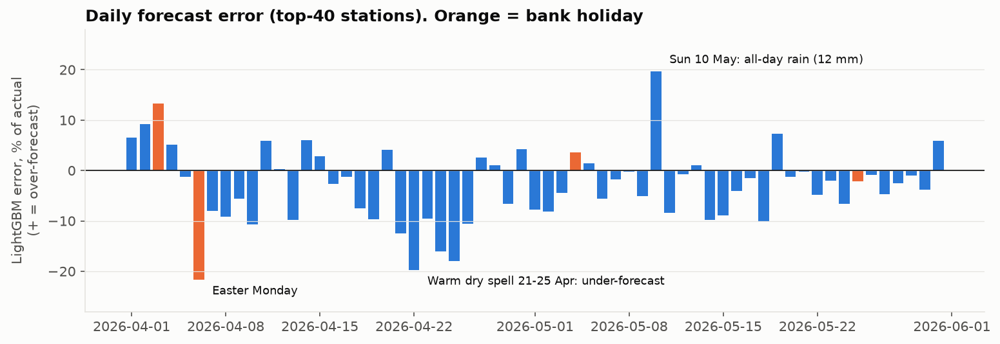
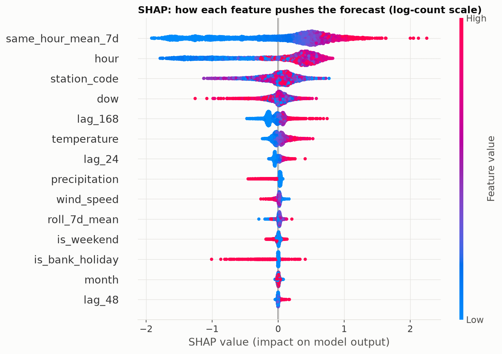
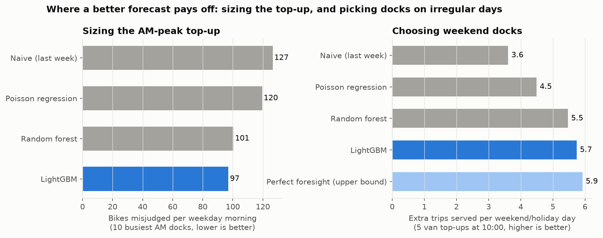

# Santander Cycles: forecasting station demand to target bike rebalancing

## The business problem

| | |
|---|---|
| **Stakeholder** | Operations manager at London's bike-share operator (Santander Cycles, run for TfL) |
| **Problem** | Docking stations run **empty** (riders can't start a trip) or **full** (riders can't end one). Vans move bikes between stations, but van hours are costly and limited. |
| **Decision supported** | Which stations need bikes moved, and at what time of day, based on forecast demand |
| **Success metric** | Forecast accuracy (MAE, WAPE) against a naive baseline, plus an estimate of how many unmet trips better rebalancing could prevent |

## Headline results

* **The forecast beats the naive baseline by 27%.** LightGBM forecasts hourly departures at the 40 busiest stations with **WAPE 45.0%, against 61.8%** for "same hour last week". At the level vans are planned (station × day × time window), error falls from **38.0% to 25.3%**.
* **Weekday mornings are a structural problem.** The same ~10 docks (Waterloo ×2, King's Cross, Paddington ×2, Hoxton, Angel, Elephant & Castle, Kensington Gardens) need bikes every weekday. Waterloo Station 3 loses a net **~163 bikes between 07:00 and 10:00 against 35 docks**, so it empties more than four times over.
* **Estimated impact (assumptions below):** one pre-06:00 top-up to 90% full at those 10 docks would serve **≈300 extra morning-peak trips per week** (range 120-530 depending on how full docks are at dawn), out of ≈1,500 that would otherwise hit an empty dock.
* **Where the better forecast earns its keep:**
  1. **Sizing the drop.** It misjudges morning demand at those 10 docks by **97 bikes per weekday instead of 127**, so about 30 fewer bikes are sent to the wrong place every morning (−23%).
  2. **Irregular days.** On weekends and bank holidays, LightGBM-chosen top-ups serve **~60% more trips than naive-chosen ones**. On bank holidays the naive forecast's hourly error (WAPE 117%) is nearly double LightGBM's (62%).
* **Weather:** the model says **1 mm/h of rain cuts expected daytime departures by ~25%**, and even a 0.2 mm drizzle cuts them by ~16%. Each extra 1°C adds ~550 trips/day on weekdays and ~635 at weekends across the network. Holding everything else fixed, the model puts a 25°C day ~9% above a 15°C day, and a 5°C day ~14% below.



## The rebalancing recommendation

The full table (400 station × day-type × window rows, 53 actions) is in `dashboard/data/rebalancing_recommendations.csv`. These are the top priorities from the Apr-May 2026 forecast:

| # | Station | When | Docks | Forecast net drain | Drain ratio | Action |
|---|---|---|---|---|---|---|
| 1 | Waterloo Station 3 | Weekday 07-09 | 35 | +163 bikes | 4.7 | Fill to 90%+ by 06:30, second top-up mid-peak |
| 2 | Waterloo Station 3 | Weekday 16-18 | 35 | −160 | −4.6 | Clear to at most 20% by 15:30 (it fills with returning commuters) |
| 3 | Queen Street 1, Bank | Weekday 07-09 | 22 | −84 | −3.8 | Clear to at most 20% by 06:30 |
| 4 | Queen Street 1, Bank | Weekday 16-18 | 22 | +38 | 1.7 | Fill to 90%+ by 15:30 |
| 5 | St James's Square | Weekday 07-09 | 40 | −67 | −1.7 | Clear to at most 20% by 06:30 |
| 6 | Waterloo Station 1 | Weekday 07-09 | 36 | +59 | 1.6 | Fill to 90%+ by 06:30, second top-up mid-peak |
| 8 | Serpentine Car Park | Weekend 10-15 | 18 | +29 | 1.6 | Fill to 90%+ by 09:30, second top-up |
| 9 | Hyde Park Corner | Weekend 10-15 | 36 | +54 | 1.5 | Fill to 90%+ by 09:30, second top-up |

*Drain ratio = (forecast departures − expected arrivals) ÷ docks. A ratio of 1.0 means the window would empty a full dock.*

The flows pair up naturally. Bikes **cleared from City docks in the morning** (Bank, St James's, Moorgate, Liverpool St) are the ones the **mainline docks need in the evening**, and the reverse. A van route Waterloo ↔ City covers both problems.

### How the impact was estimated (an estimate, not a measurement)
For each non-holiday weekday in Apr-May 2026: rank docks by forecast morning drain the night before, send the van to the top 10, then replay the **actual** hour-by-hour departures and arrivals from 06:00 to 10:00.
* Docks start at **50% full** (sensitivity tested at 30% and 70%). The van fills the chosen docks to **90%** before 06:00.
* A rider who finds an empty dock counts as a lost trip.
* Arrivals within the hour can be re-hired that hour. This is optimistic, so lost trips are a lower bound.
* The comparison is targeted van vs **no** van. TfL's actual current operations aren't public.
* Observed departures are already capped by bike availability, so true demand at the busiest docks is probably higher.

## Approach

```
data/raw  ──►  src/cleaning.py  ──►  SQLite (sql/*.sql)  ──►  src/features.py  ──►  src/models.py  ──►  src/rebalancing.py  ──►  dashboard/data/*.csv
 24 extracts    standardise,          top-40 stations,        calendar, weather,       naive → Poisson →       risk table, van            Power BI
 BikePoint      dedupe, filter,       hourly grid with        lags (>= 24h),           RF → LightGBM,          simulation
 Open-Meteo     fix station codes     zero-fill (SQL)         capacity, coords         time-based split
 gov.uk BH
```

### Data
| Source | What | Notes |
|---|---|---|
| [TfL cycling open data](https://cycling.data.tfl.gov.uk/) | 24 journey extracts, **1 Jun 2025 to 31 May 2026**, 9.09M trips | Since 2022 the files are **fortnightly**, not weekly, and the schema changed (see below) |
| [TfL BikePoint API](https://api.tfl.gov.uk/BikePoint) | 792 stations: coordinates, dock count | Snapshot taken Nov 2026 |
| [Open-Meteo archive](https://open-meteo.com/en/docs/historical-weather-api) | Hourly temperature, rain, wind for central London | Local time |
| [gov.uk bank holidays](https://www.gov.uk/bank-holidays.json) | England & Wales | Plus approximate London school holidays, hard-coded |

### Cleaning decisions (notebook 01)
* **Schema drift.** Current files use `Number, Start date (yyyy-mm-dd), Start station number, Total duration (ms), Bike model`. Pre-2022 files used `Rental Id, Start Date (dd/mm/yyyy), StartStation Id, Duration (s)`. `cleaning.COLUMN_MAP` handles both, so older years can be added without code changes.
* **Trip filters.** Drop trips under 1 minute (false starts), over 3 hours (lost or mis-docked bikes), and same-dock round trips under 2 minutes (bike swaps). 98.7% of trips are kept.
* **Station renames.** Names change, so the join key is the TfL terminal code. When a dock is relocated, TfL retires the old code by appending 4s (`200025` → `200025444`) and suffixes the name with `_OLD`. 11 such codes (58,631 trip-ends) are merged back onto the live station.
* **Data incidents found.** **5 Aug 2025** has only 183 trips against ~25k normally: a system outage. It is masked from training and evaluation. **8-11 Sep 2025** is the year's busiest week (up to 45k trips/day), coinciding with the London Underground strike. It is real demand, so it is kept.

### Why 40 stations
The top 40 start stations are 5% of stations but 13.4% of departures. They cover every behaviour type that matters for operations, and give 350k station-hours: enough to model properly, small enough to iterate on. One busy station, **Cheapside, Bank** (rank 26), had to be excluded because it is missing from the current BikePoint feed, so its capacity is unknown.

### SQL layer (`sql/`)
Cleaned trips are loaded into SQLite. The station ranking, the **zero-filled hourly station grid** (recursive calendar CTE × stations, with left-joined departure and arrival counts) and the station profiles are all built in SQL. See `sql/04_hourly_demand.sql`.

### EDA highlights (notebook 02)
* Weekdays have two sharp commuter peaks (08:00 ≈ 3,150 trips/h network-wide; 17:00 ≈ 2,850). Weekends have one broad afternoon hump. The busiest month is 1.6× the quietest.
* Stations fall into clear **characters**, classified by rules on their SQL profiles: *Morning origin* (Waterloo, King's Cross, Paddington: the AM peak is ≥30% of departures), *Office / City* (Bank, Moorgate, Liverpool St: fill in the morning, drain in the evening), *Leisure / park* (Hyde Park, Serpentine: ≥30% of trips at weekends), and *Mixed*. K-means was tried first. It produced a lopsided split and was dropped in favour of rules operations can follow.

| | |
|---|---|
|  |  |
|  |  |

### Modelling (notebook 03)
* **Features:** hour, day of week, month, weekend, bank holiday, school holiday, temperature, rain, wind, lags (same hour yesterday, 2 days ago, last week), 7-day same-hour mean, 7-day rolling mean, docks, lat/lon, station id. **Every lag is ≥ 24 h**, so the forecast can be made the evening before.
* **Validation:** strict **time-based split**. Train Jun 2025 - Mar 2026, test **Apr - May 2026** (58,560 station-hours, including 4 bank holidays). There is no random split, because adjacent hours would leak.

| Model | MAE | RMSE | WAPE (station-hour) | WAPE (station-day-window) | vs naive |
|---|---|---|---|---|---|
| Naive (same hour last week) | 2.32 | 4.36 | 61.8% | 38.0% | n/a |
| Poisson regression | 1.92 | 3.43 | 51.1% | 31.9% | −17% |
| Random forest | 1.81 | 3.28 | 48.2% | 28.4% | −22% |
| **LightGBM (Poisson objective)** | **1.69** | **2.97** | **45.0%** | **25.3%** | **−27%** |

Hourly WAPE looks high because station-hour counts are small (mean ≈ 3.8 trips). Vans are planned on windows, where error is much lower.

**Where it fails:**
* **Bank holidays** (WAPE 62%, though naive is 117%).
* **Weekends** (53% vs 42% on weekdays), because leisure demand is weather-driven and irregular.
* **All-day rain**: Sunday 10 May (12 mm) was over-forecast by ~20%.
* **Early warm spells**: 21-25 April was under-forecast by 10-20%.
* **Events** like the September Tube strike have no feature at all.

The weather results are optimistic: the test uses *observed* weather in place of a day-ahead forecast.




**Explainability.** Recent demand (same-hour lags, rolling means) and hour of day dominate. Weather is the next biggest driver. A note on humidity: in a first version it acted as a proxy for "wet day" and absorbed the rain effect. Removing it left accuracy unchanged and made the rain effect monotone and consistent with the raw data.

| Rain in the hour | 0.2 mm | 0.5 mm | 1 mm | 2 mm | 4 mm |
|---|---|---|---|---|---|
| Predicted daytime demand vs dry | −16% | −23% | −25% | −26% | −29% |



### Forecast value (notebook 04)


## Dashboard
`dashboard/README.md` has the Power BI build: the data model, DAX measures and three page specs (**Demand patterns · Forecast vs actual · Rebalancing plan**). All of it is fed by the CSVs in `dashboard/data/`.

## Limitations and next steps
* **No dock-occupancy history.** TfL doesn't publish one, so empty and full events are simulated. Collecting BikePoint snapshots every few minutes for a month would let the starting-fill assumption be calibrated and censored demand be measured.
* **Arrivals aren't forecast.** They use a typical recent profile. Forecasting arrivals with the same pipeline is the obvious next step for full net-flow risk.
* **Day-ahead weather forecasts** should replace observed weather to get honest operational accuracy.
* **An events calendar** (strikes, concerts, Hyde Park festivals) would cover the biggest known failure mode.
* **Van routing** (capacity, travel time between docks) would turn the station list into a schedule.

## Reproduce
```bash
uv venv --python 3.11 .venv && uv pip install --python .venv/bin/python -r requirements.txt
source .venv/bin/activate
./run_all.sh          # downloads ~1.5 GB, runs notebooks 01-04 (~15 min on a laptop)
```
*macOS note: LightGBM needs OpenMP (`brew install libomp`).*

## Repo structure
```
tfl-cycle-demand/
├── README.md
├── data/
│   ├── raw/                 journeys (downloaded), reference/ (BikePoint, weather, bank holidays, file index)
│   └── processed/           clean journeys (parquet), SQLite DB, features, test predictions, station types
├── notebooks/               01_cleaning · 02_eda · 03_modelling · 04_rebalancing
├── sql/                     schema, indexes, top stations, hourly grid, station profiles
├── src/                     config, download, cleaning, db, features, models, rebalancing, plotting
├── models/                  lightgbm_departures.txt
├── reports/                 figures/, model_metrics.csv, impact_estimate.csv, sizing_error.csv, ...
└── dashboard/               Power BI spec (README.md) and data/ exports
```

## Data licence
Journey and BikePoint data: Powered by TfL Open Data. Contains OS data © Crown copyright and database rights 2016 and Geomni UK Map data © and database rights 2019. Weather: [Open-Meteo](https://open-meteo.com/) (CC BY 4.0). Bank holidays: gov.uk, Open Government Licence v3.0.
